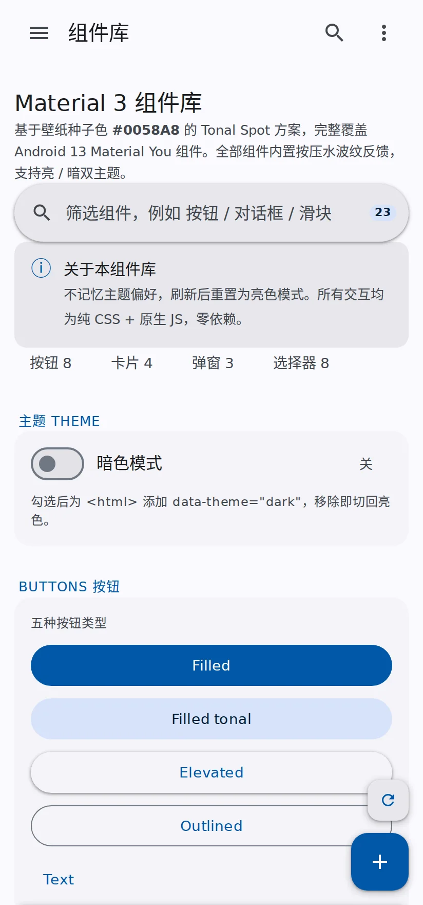
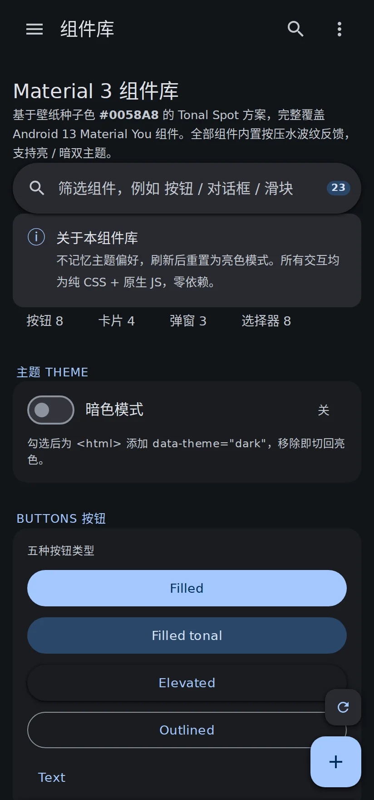
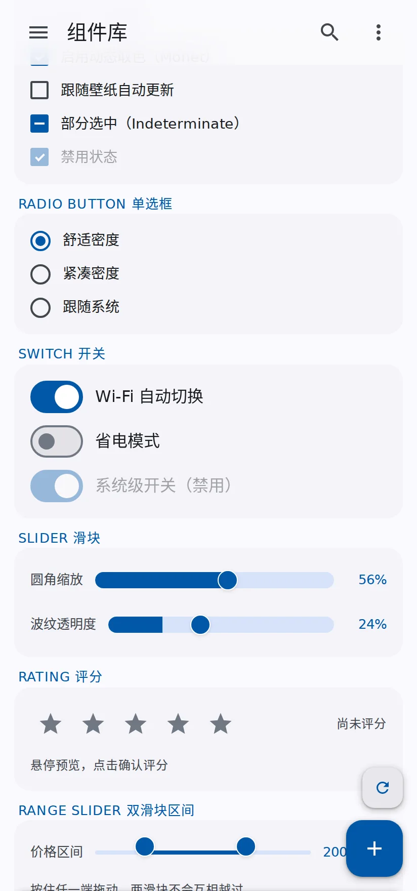
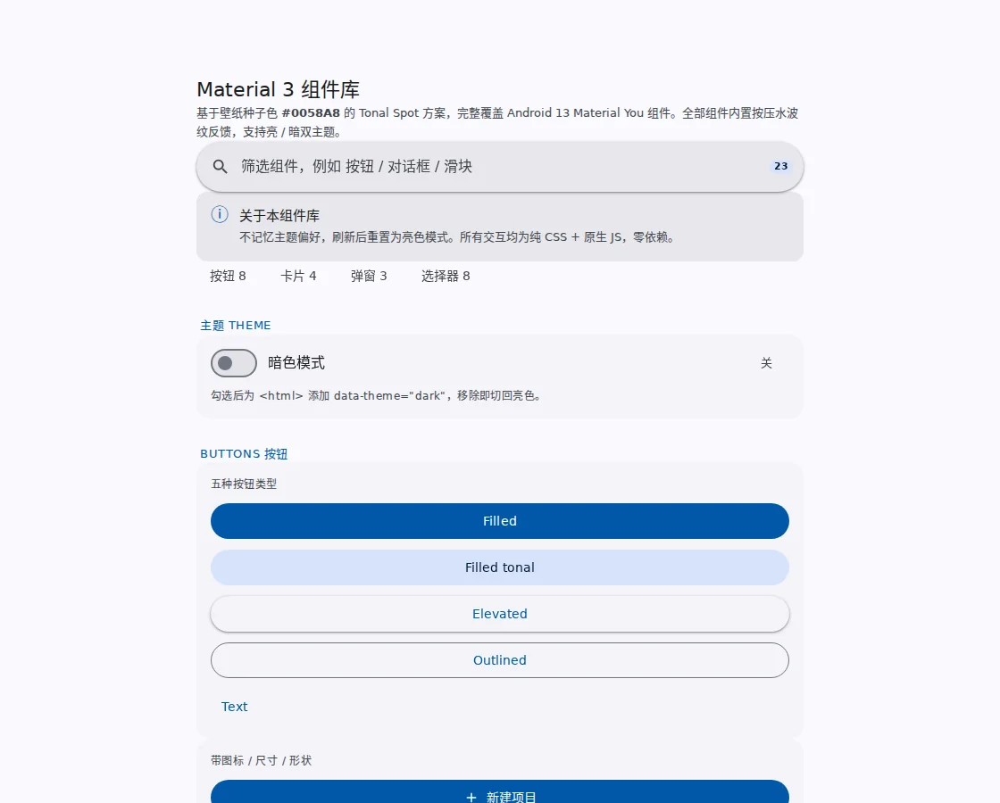

# Material 3 组件库与设计规范

[](https://github.com/frank-bonus18/m3-design-spec/actions/workflows/check.yml)
[](LICENSE)
[](https://frank-bonus18.github.io/m3-design-spec/)
[](https://m3.material.io/)

一套完整的 **Material 3（Material You / Android 13）** 前端实现：单文件组件库、72 个设计令牌、四个质量检查工具。零依赖，双击就能用。

**▶ [在线预览](https://frank-bonus18.github.io/m3-design-spec/)** — 不用下载，点开就能点。

<p align="center">
  
  
  
</p>

<p align="center">
  
</p>

---

## 你会拿到什么

| 内容 | 说明 |
|---|---|
| **组件库**（515 KB 单文件 HTML） | 24 个区块、298 个组件类。双击打开即用，不联网、不起服务器 |
| **设计令牌** | 72 个语义色，亮/暗双套完整镜像，附 5 级圆角、5 级阴影、动效常量 |
| **四个检查工具** | 静态校验 / 运行时执行 / 键盘可达性审计 / 129 项行为回归 |
| **AI 技能包** | 同一套内容封装成 agent skill，让 AI 按统一规范产出界面 |

产物是**纯 HTML + CSS + 原生 JS**：没有框架、没有构建、没有 `npm install`。

---

## 三种用法，挑一个

### 用法一：只想用组件

```bash
# 下载单文件，双击打开
curl -LO https://raw.githubusercontent.com/frank-bonus18/m3-design-spec/main/m3-design-spec/assets/m3-component-library.html
```

或者直接打开[在线预览](https://frank-bonus18.github.io/m3-design-spec/)，右键查看源码，把你需要的组件和 CSS 变量复制到自己的项目里。

用它搭界面时只需要记住一件事：**颜色一律走 `var(--token)`**。硬编码一个 `#0058A8`，暗色模式就在那一处失效了。

### 用法二：装成 AI 技能

需要助手支持 skills（技能）机制。装好后，让它"用 M3 风格做个设置页"，它会自动按这套规范产出。

```bash
git clone https://github.com/frank-bonus18/m3-design-spec.git
cd m3-design-spec
./install.sh
```

`install.sh` 会复制技能到 `${SKILLS_DIR:-/skills}/`、给脚本加执行权限，然后跑一遍检查确认装好了。

已有旧版本时会备份到 `${SKILLS_DIR}/.m3-backups/` —— 特意放点目录里，因为 skills 目录下任何含 `SKILL.md` 的子目录都可能被扫描器当成一个技能。

装到别处：

```bash
SKILLS_DIR=~/my-skills ./install.sh
```

**连不上 github.com 怎么办？** 某些网络下 `github.com:443` 会被阻断（TCP 能连，TLS 握手挂死），但 `api.github.com` 正常。这时用网页：仓库页 → 绿色 **Code** → **Download ZIP**，解压后按手动安装三步走：

```bash
mkdir -p /skills
cp -a m3-design-spec /skills/
chmod +x /skills/m3-design-spec/scripts/*
```

### 用法三：只取设计令牌

```
m3-design-spec/references/tokens.md      # 72 个色值的表格，亮/暗双列
```

想换成自己的品牌色？照 [references/tokens.md](m3-design-spec/references/tokens.md) 末尾的规则生成：由种子色推 5 档色调（Tone 0/10/30/50/90），亮色 `--primary` 取 Tone 40、暗色取 Tone 80，然后逐对检查对比度。**不达标时调色调，不要调色相。**

---

## 它解决什么

手写 M3 界面，反复踩的就是这几个坑：

| 坑 | 后果 | 这套东西怎么处理 |
|---|---|---|
| 组件里硬编码颜色 | 暗色模式局部失效 | 静态检查扫令牌块外的十六进制 |
| 暗色令牌漏写几个 | 切主题时个别元素不变色 | 逐名比对两个令牌块 |
| 水波纹逐元素绑定 | 动态插入的节点没有反馈 | 事件委托，一个 `pointerdown` 覆盖全站 |
| 可点元素不是按钮 | 键盘用户够不到 | 审计所有「有点击但不可聚焦」的元素 |
| 只做手机宽度 | 平板上是一根细条浮在空白里 | 强制要求 `min-width` 断点 |
| 通知上限写成 `while(children.length >= 3)` | **同步死循环，标签页卡死** | 运行时 harness 会挂住，暴露问题 |
| `try{…}catch(e){}` 包住初始化 | 报错被吞，检查器以为一切正常 | 空 catch 检测 |

这些不是靠人记的规矩，是能跑出来的检查。

---

## 一条命令跑完检查

```bash
./m3-design-spec/scripts/check.sh
```

12 秒，四项检查，一行结论：

```
检查 m3-design-spec/assets/m3-component-library.html

  ✓ 静态校验 291 个按钮 · 261 个组件类
  ✓ 运行时 3065 个元素
  ✓ 键盘审计 无不可达目标（7 个期望例外）
  ✓ 行为回归 通过 138 项
结果: ✅ 全部通过（12s）
```

失败时自动展开细节。也支持：

```bash
./check.sh path/to/page.html    # 检查指定页面
./check.sh --verbose            # 总是展开每项输出
./check.sh --json               # 机器可读，给 AI 或 CI 解析
```

退出码：`0` 通过 / `1` 有问题 / `2` **缺少依赖**。

> `2` 不是通过。缺 node 或 python3 时脚本明确说「无法给出结论」，绝不让「没检查」看起来像「检查通过」。

## 四项检查各自管什么

### `check_m3_html.py` — 静态校验

标签闭合、`id` 唯一、JS 引用的 id/class 是否存在、令牌块外的硬编码颜色、两套令牌是否完整镜像、无障碍（`lang` / 跳转链接 / 按钮无障碍名 / 覆盖层 `role` / 实时播报区 / `prefers-reduced-motion` / `:focus-visible` / emoji 当图标）、响应式（viewport / 是否禁止缩放 / 是否有 `min-width` 断点），以及**内容门槛**：

| 指标 | 下限 |
|---|---|
| `<button>` | 20 |
| `<section>` | 4 |
| `m3-*` 类 | 30 |
| 内联 `<svg>` | 5 |
| 可见文字 | 40 字符 |

这条是为了挡住「280 字节空壳 + 正确外壳」——它曾能让三项检查全绿。

### `dom_harness.js` — 运行时执行

解析 HTML 建最小 DOM，注入浏览器 API，执行页面脚本。抓静态分析看不见的东西：加载期异常、同步死循环、交互逻辑写错。

```js
const H = require('./m3-design-spec/scripts/dom_harness.js');
const { doc, fire, loadError } = H;
if (loadError) throw loadError;

doc.querySelector('#themeToggle').click();
fire(doc.querySelector('#dpGrid'), 'keydown', { key: 'ArrowRight', preventDefault() {} });
```

**能力边界**：不是浏览器。Canvas 是桩、布局是常量、观察器是空实现。

### `audit_keyboard.js` — 键盘可达性

找出「有点击监听但不可聚焦」的元素。遮罩和禁用按钮是期望例外。

### `regression_tests.js` — 行为回归

138 项断言：主题切换、四类覆盖层（含焦点陷阱和 `inert`）、通知堆叠、步进器、日期选择器键盘模型、时间选择器拖动、下拉与多选、表单校验、手势、命令面板、组合控件键盘规则、规范可视化、缩放适配、动态重建后键盘支持是否还在。

每个断言块独立捕获异常 —— 某块崩了记为失败并继续，你会拿到完整的坏点清单而不是崩在第一处。

### `selfcheck.py` — 防止检查器被削弱

```bash
python3 m3-design-spec/scripts/selfcheck.py
```

对 **14 种**已知缺陷做变异测试，断言每个都被检出。规则被删掉时它立刻变红 —— 否则「检查通过」就是一句空话。

## 这些检查能不能被糊弄？

**能。** 我实测过：给组件库加了 4 种作弊，原来的四个工具**全部被骗过**。

| 作弊手法 | 为什么骗得过 | 现在 |
|---|---|---|
| `try{ 全部逻辑 }catch(e){}` | 运行时只报"无异常"，异常被吞了 | 检出 |
| `aria-label=""` | 只检查属性存在，不检查非空 | 检出 |
| 给 `<div>` 加 `tabindex="0"` | 只问"能否聚焦"，不问"能否操作" | 检出 |
| 检测 `navigator.userAgent === 'node'` | harness 自己把 UA 设成了 `node` | 检出 |

已加固：空 catch 检测、环境嗅探检测（UA 换成真实 Chrome Android，`process`/`require`/`module` 遮蔽为 `undefined`）、无 `role` 的 `tabindex` 检测、空 `aria-label` 判负，外加 `selfcheck.py` 防篡改。

### 但仍然证明不了什么

- 静态检查读的是**模式**，不是意图。换种没见过的写法就漏
- harness 不是浏览器：没有布局、没有真实 `getBoundingClientRect`
- 回归测试只断言它断言的东西。**专门为满足断言而写的页面照样能过**
- **最终还是要人打开页面用一遍**：键盘走一遍、双指捏一下、开读屏听一遍

脚本的作用是缩小排查范围，不是签发合格证。

---

## 键盘与无障碍

全站可纯键盘操作：

| 按键 | 作用 |
|---|---|
| `?` | 快捷键帮助 |
| `Ctrl` / `⌘` + `K` | 命令面板 |
| `g` 后接字母 | 快速跳转（`g g` 顶部、`g a` 操作、`g n` 导航、`g f` 表单、`g d` 数据、`g u` 认证、`g k` 键盘、`g t` 主题） |
| `Esc` | 关闭当前浮层 |

组合控件遵循 roving tabindex：标签页、芯片、单选框、日期格、树、列表框整组只占一个 Tab 停靠点，组内用方向键。

日期选择器：`←→` ±1 天、`↑↓` ±1 周、`Home/End` 周首末、`PageUp/PageDown` ±1 月、`Enter` 选定。

页面暴露一个机器可读的注册表，AI 或自动化脚本可以直接枚举调用，不用模拟按键：

```js
window.m3Keys.commands        // [{ id, group, label, keys, run }]
window.m3Keys.invoke('theme') // 执行并返回是否成功
window.m3Keys.format('cmdk')  // → 'Ctrl + K'
```

---

## 关于「禁止缩放」

检查器会报 `user-scalable=no` 和 `maximum-scale=1`，因为那会让视力不佳的人无法放大看字（违反 WCAG 1.4.4）。

双指缩小后右侧出现空白是浏览器行为：布局视口宽度不变，可视视口变宽，多出来的是文档之外。CSS 无法消除。要处理就用 `visualViewport` 感知缩放比、缩小时按比例放大整页 —— **保留缩放能力**，而不是禁用它。参考实现就是这么做的。

---

## 内容

```
m3-design-spec/
├── SKILL.md                    技能主体
├── references/
│   ├── tokens.md               72 个令牌，亮/暗双值（从代码自动抽取）
│   ├── components.md           298 个类的目录
│   └── keyboard.md             键位表、roving tabindex、AI 接口
├── scripts/
│   ├── check.sh                ★ 一条命令跑完下面四项
│   ├── check_m3_html.py        静态校验
│   ├── dom_harness.js          运行时执行
│   ├── audit_keyboard.js       键盘可达性
│   ├── regression_tests.js     行为回归
│   └── selfcheck.py            防篡改自检
└── assets/
    ├── m3-component-library.html   参考实现（约 11,000 行）
    └── full-spec-doc.md            人类可读的规范文档
```

覆盖组件：按钮 / FAB / 卡片 / 芯片 / 输入框 / 选择控件 / 导航 / 进度 / 覆盖层 / 日期时间选择器 / 表格 / 手势 / 认证表单 / 键盘优先组件 / 设计规范可视化（色板、对比度检查、动效曲线、字阶）。

---

## 环境要求

- **Python 3.8+**（只用于静态校验和自检，纯标准库）
- **Node.js 18+**（运行时、审计、回归）
- 不需要 `npm install`，不需要 `pip install`

生成的页面面向现代浏览器：Chrome / Edge / Firefox / Safari。

---

## 已知限制

- 运行时 harness 不实现布局，`getBoundingClientRect` 返回常量矩形 —— 滚动跟随、粘性定位、焦点环是否被 `overflow` 裁切，仍需真机验证
- 第三方登录图标是手写单色 SVG，形状未逐像素校对；商用前建议换成官方素材
- 日期选择器的初始「今天」写死为 2026-10-11，复制使用时记得改
- 树形控件的 `role="treeitem"` 在父元素上、`tabindex` 在子元素上，与 ARIA 规范建议略有出入（当前靠白名单放行，未改结构）

---

## 贡献

欢迎提 issue 和 PR。改完代码跑一条命令：

```bash
./m3-design-spec/scripts/check.sh
```

改了 `scripts/` 里的东西，再跑一次自检：

```bash
python3 m3-design-spec/scripts/selfcheck.py
```

两项都绿了再提交。CI 会做同样的事，跑不过会红。

## 许可

[MIT](LICENSE) · 假期未知工作室
